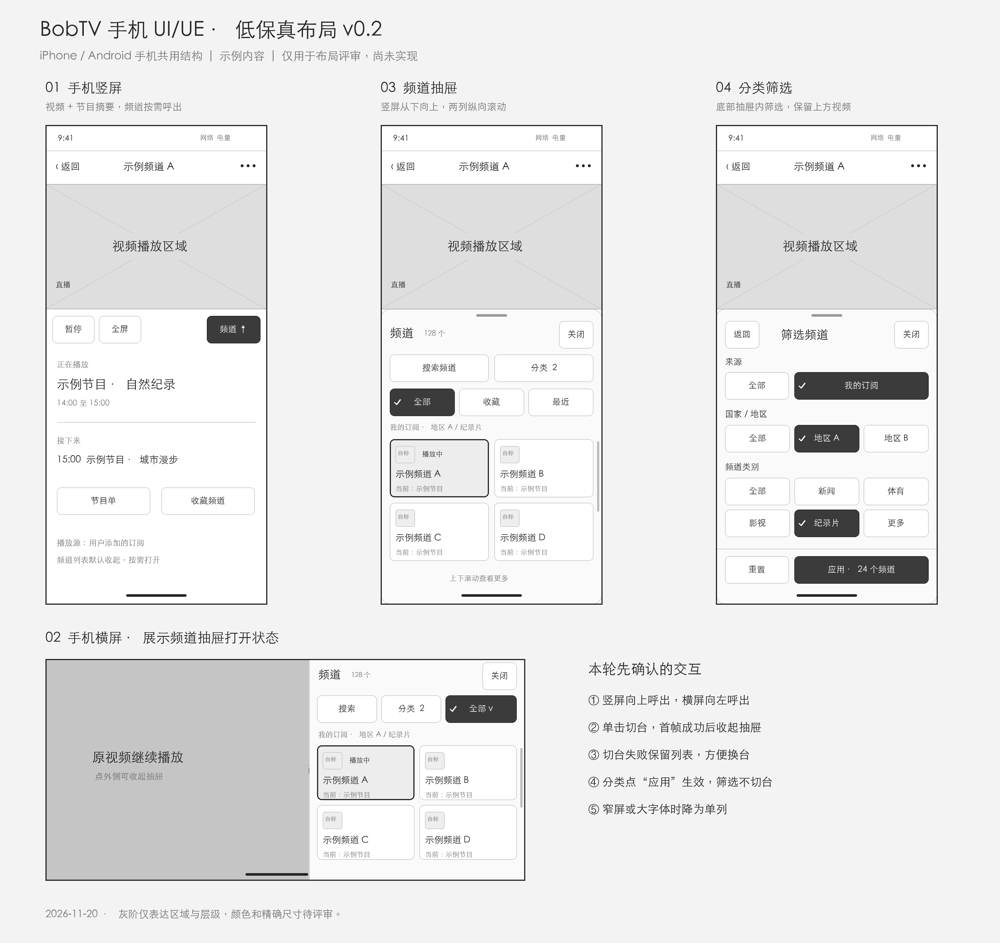

# 手机低保真图 v0.2

日期：2026-11-20。静态规划图，频道与节目均为示例，仅用于 UI/UE 评审。未修改应用代码。

## 单独查看

- [手机竖屏，抽屉关闭](./01-phone-portrait-v02.png)
- [手机横屏，抽屉关闭](./02a-phone-landscape-closed-v02.png)
- [手机横屏，抽屉打开](./02-phone-landscape-drawer-v02.png)
- [手机频道抽屉，两列纵向列表](./03-channel-drawer-v02.png)
- [分类筛选，大按钮与底部应用](./04-category-filter-v02.png)

分类页显示为抽屉内部模式，返回后回到频道网格。频道抽屉底部“上下滚动查看更多”为线框说明，不是产品按钮。图中选中项采用深色填充和勾选标记。

横屏和竖屏示意中的控制层处于可见状态。真实交互中控制层可以隐藏；打开抽屉不改变底层视频几何，不停止播放。切台成功后收起、失败时保留列表是待评审建议。

本版方向：竖屏从底部向上呼出，横屏从右向左呼出。竖屏分类沿用底部抽屉。上方视频保留，频道网格仍最多两列纵向滚动。旧 v0.1 图片保留供对照。

本轮优先审查：手机竖屏的频道入口位置；抽屉宽度与两列信息密度；分类是否容易点选；横屏抽屉是否占用过多观看区域。源管理与节目单详情未在本轮展开。

`render_wireframes_v02.py` 仅为静态设计图片的复现脚本，使用 Pillow 和本机中文字体，不连接应用运行时，也不实现 Flutter UI。
